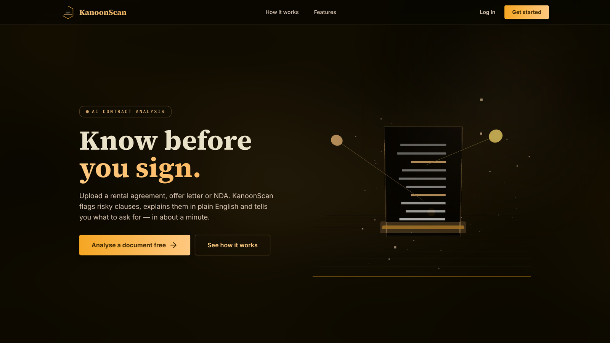
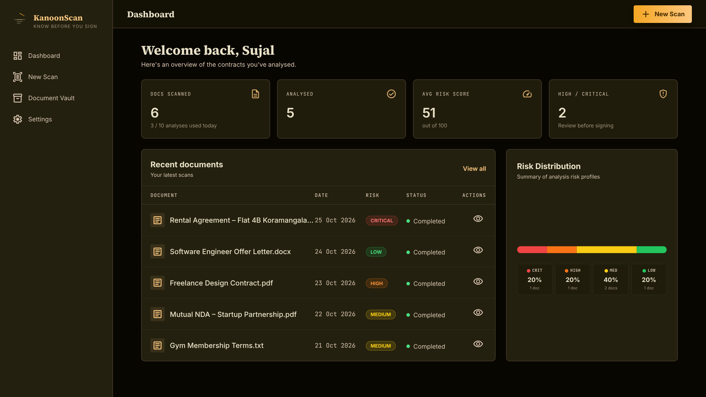
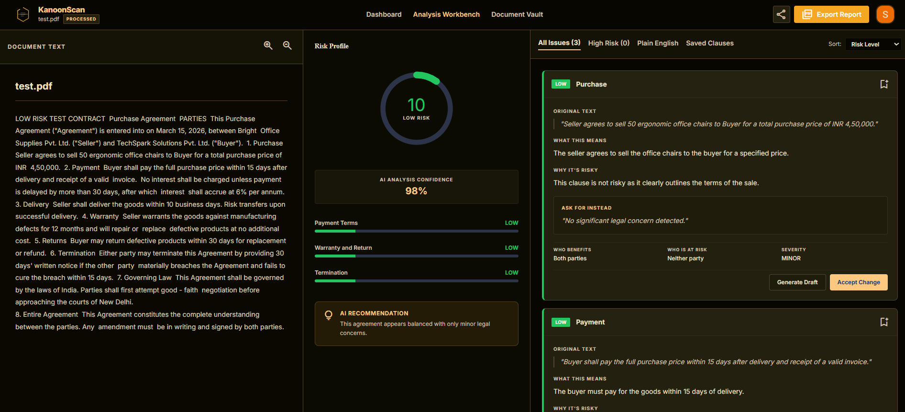
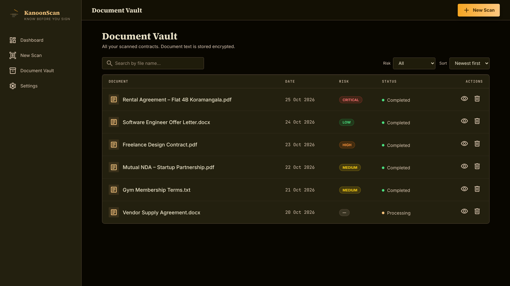
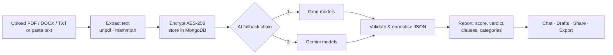

# ⚖️ KanoonScan

> **Know Before You Sign** — an AI contract analyser that flags risky clauses, explains them in plain English and tells you what to ask for before you sign.

<p align="center">
  <a href="https://kanoonscan.vercel.app/"></a>
</p>
<p align="center">
  
  
  
  
  
  
</p>



---

## 📖 Overview

Most people sign rental agreements, offer letters and NDAs without reading every clause. KanoonScan reads the contract for you:

1. **Upload** a PDF, DOCX or TXT file — or paste the text.
2. **AI analysis** rates every clause from low to critical risk and gives the whole document a 0–100 risk score.
3. **Review** a plain-English summary, who each clause favours, why it's risky and a suggested fairer alternative — then ask follow-up questions in chat.

Document text is encrypted at rest, and you can delete any document — or your whole account — at any time.

---

## ✨ Features

| | Feature | Details |
|---|---|---|
| 🔍 | **Clause-level risk analysis** | Every risky clause is extracted with its original text, risk level (low → critical), explanation, who benefits / who's at risk and a suggested fix |
| 📊 | **Risk score & verdict** | 0–100 score, risk breakdown by category and an overall verdict (e.g. *Seek Legal Advice*) |
| 🗣️ | **Plain-English summary** | Legalese rewritten into short, readable explanations |
| 🧾 | **Key details extraction** | Parties, dates, rent/payment terms, notice periods, renewal and governing law |
| 💬 | **Chat with your contract** | Ask "Can I terminate early?" and get answers grounded in the document; history is saved |
| ✍️ | **Fairer clause drafts** | Generate an improved alternative for any risky clause |
| 🔗 | **Shareable reports** | Turn on a read-only public link (document text is never exposed) and turn it off any time |
| 📄 | **PDF export** | Download a clean, print-friendly report |
| 🗂️ | **Document vault** | Search, filter by risk, sort and delete past scans |
| 🛡️ | **Fair-use limits** | Per-user daily limits on AI analyses and chat messages |
| 📱 | **Responsive UI** | Works on desktop and mobile |

---

## 📸 Screenshots

### Dashboard


### Contract Analysis


### Document Vault


---

## 🛠️ Tech Stack

| Layer | Technology |
|---|---|
| Framework | Next.js 14 (App Router), React 18, TypeScript |
| Styling | Tailwind CSS, Three.js (landing animation) |
| Auth | Clerk (sign-up, login, account management) |
| Database | MongoDB Atlas (native driver, `$jsonSchema` validation) |
| AI | Groq (Llama 3.3 70B and others) with Google Gemini 2.5 fallback |
| Document parsing | unpdf (serverless pdf.js), Mammoth (DOCX) |
| Hosting | Vercel |

---

## 🧠 How It Works



- **Resilient AI:** each model is tried in turn; any failure (rate limit, request too large, retired model) moves on to the next. Long documents go to Gemini first because of its larger context window. Model names can be changed with environment variables, without code changes.
- **Consistent output:** the AI's JSON is parsed defensively, risk labels are normalised to `LOW / MEDIUM / HIGH / CRITICAL`, and scores are clamped to 0–100 before saving.
- **Fair use:** daily limits are counted atomically in MongoDB, reset at midnight IST, and refunded automatically when the AI call fails.

---

## 🔐 Security & Privacy

- **Authentication** with Clerk; every API route checks the session and that the user owns the requested document.
- **Encryption at rest:** document text is encrypted with AES-256 before it's stored, and decrypted only in memory.
- **Public links** use random 144-bit tokens, show only the report (never the full document) and are excluded from search engines.
- **Right to erasure:** deleting your account removes all documents, analyses, chats, logs and your Clerk login.
- **Audit log** of uploads, analyses, deletions and sharing changes.

---

## 🗄️ Database Schema

MongoDB is schemaless, so the schema is enforced with `$jsonSchema` validators and indexes defined in [`lib/db/schema.ts`](lib/db/schema.ts). They're applied automatically on the first connection; you can also run [`scripts/mongo-schema.js`](scripts/mongo-schema.js) in mongosh.

| Collection | Key fields | Indexes |
|---|---|---|
| `users` | clerkId, email, name | clerkId (unique) |
| `documents` | userId, name, type, rawText (encrypted), status | userId + createdAt |
| `analyses` | documentId, riskScore (0–100), riskLevel, summary, verdict, keyInformation, shareToken | documentId (unique), shareToken (unique) |
| `clauses` | analysisId, title, originalText, riskLevel, suggestion, isSaved | analysisId + position |
| `riskCategories` | analysisId, name, score, level | analysisId |
| `chats` | analysisId, role (USER/ASSISTANT), message | analysisId + createdAt |
| `rate_limits` | key (user:action:day), count, expiresAt | key (unique), expiresAt (TTL) |
| `audit_logs` | userId, action, details | userId + createdAt |

---

## 🚀 Getting Started

### Prerequisites
- Node.js 18+
- A [Clerk](https://clerk.com) application
- A [MongoDB Atlas](https://www.mongodb.com/atlas) cluster (the free tier works)
- An API key for [Groq](https://console.groq.com) and/or [Google AI Studio (Gemini)](https://aistudio.google.com)

### Setup

```bash
git clone https://github.com/Sujal-tyagi17/Kanoon-Scan.git
cd Kanoon-Scan
npm install
cp .env.example .env.local   # then fill in the values
npm run dev                  # http://localhost:3000
```

### Environment variables

| Variable | Required | Purpose |
|---|---|---|
| `NEXT_PUBLIC_CLERK_PUBLISHABLE_KEY` | ✅ | Clerk publishable key |
| `CLERK_SECRET_KEY` | ✅ | Clerk secret key |
| `DATABASE_URL` | ✅ | MongoDB connection string — use the `mongodb+srv://` form and include a database name, e.g. `…mongodb.net/kanoonscan?retryWrites=true&w=majority` |
| `GROQ_API_KEY` / `GEMINI_API_KEY` | ✅ (at least one) | AI providers |
| `ENCRYPTION_KEY` | ✅ | Long random secret for encrypting document text. Generate with `node -e "console.log(require('crypto').randomBytes(32).toString('hex'))"`. **Never change it once data exists.** |
| `WEBHOOK_SECRET` | – | Clerk webhook signing secret (optional — users are also created on first sign-in) |
| `GROQ_MODELS` / `GEMINI_MODELS` | – | Comma-separated model overrides |
| `DAILY_ANALYSIS_LIMIT` / `DAILY_CHAT_LIMIT` | – | Per-user daily limits (default 10 and 50) |

`GET /api/health` reports which variables are set (yes/no only, never the values) and whether MongoDB is reachable — useful after deploying.

### Deploying to Vercel
1. Import the repo into Vercel and add the environment variables above for **Production** and **Preview**.
2. In MongoDB Atlas → **Network Access**, allow `0.0.0.0/0` (Vercel has no fixed IP addresses).
3. Deploy, then open `/api/health` and check for `"ok": true`.

---

## 🔌 API Routes

| Route | Method | Description |
|---|---|---|
| `/api/process-document` | POST | Upload a file, extract and encrypt its text |
| `/api/analyze-text` | POST | Create a document from pasted text |
| `/api/analyze` | POST | Run the AI analysis for a document |
| `/api/chat` | POST | Ask a question about an analysed document |
| `/api/clauses/save` | POST | Bookmark or unbookmark a clause |
| `/api/share` | POST | Turn a report's public link on or off |
| `/api/documents/delete` | POST | Delete a document and everything linked to it |
| `/api/user/delete-account` | POST | Delete all of a user's data and their login |
| `/api/webhooks/clerk` | POST | Sync Clerk user events (signature-verified) |
| `/api/health` | GET | Configuration and database health check |

---

## 📊 Risk Levels

| Level | Meaning |
|---|---|
| 🟢 **Low** | Standard commercial terms with minimal concern |
| 🟡 **Medium** | Worth reviewing before signing |
| 🟠 **High** | Significant risk — negotiate this clause |
| 🔴 **Critical** | Serious concern — consider professional legal review |

---

## 📁 Project Structure

```text
app/
  (auth)/              sign-in & sign-up pages (Clerk)
  (dashboard)/         dashboard, scan, analysing, vault, analysis report, settings
  share/[token]/       public read-only shared reports
  api/                 analyze, chat, documents, share, webhooks, health
components/            landing visuals, dashboard shell, uploader, share panel, dialogs
lib/
  auth.ts              get-or-create the MongoDB user for the Clerk session
  db/                  connection, schema validators, audit log
  groq/analyze.ts      AI analysis with Groq → Gemini fallback chain
  gemini/              document chat
  rate-limit.ts        per-user daily limits
  encryption.ts        AES-256 encryption of document text
scripts/               mongosh schema script
```

---

## ⚠️ Disclaimer

KanoonScan provides AI-generated analysis for informational purposes only. It is not a law firm and does not provide legal advice. Always consult a qualified lawyer before making important legal decisions.

---

## 👨‍💻 Author

**Sujal Tyagi** — [GitHub @Sujal-tyagi17](https://github.com/Sujal-tyagi17)

---

## 📄 License

This project is licensed under the [MIT License](LICENSE).
